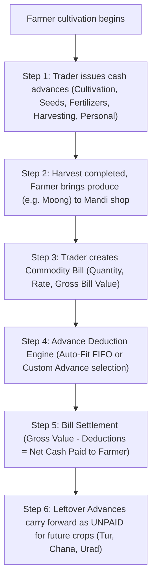

# GTCO-LEDGER

> **Commodity Trader Advance & Bill Settlement Ledger**  
> A dedicated, production-ready ledger and bill settlement application tailored for agricultural pulse and grain traders in APMC Mandis (Gururaj Trading Company).

---

## 1. Business Context & Mandi Workflow

Agricultural commodity traders regularly deal in pulses such as **Tur (Pigeon Pea)**, **Moong (Green Gram)**, **Chana (Chickpea)**, **Urad (Black Gram)**, and other seasonal produce.

### The Trader's Core Workflow



1. **Issuing Advances to Farmers**:
   - During the cultivation and growing cycles, farmers take multiple cash advances on different dates for diverse purposes (initial cultivation, seeds, fertilizers/pesticides, labor/harvesting expenses, or personal emergencies).
2. **Harvest & Produce Sale (Billing)**:
   - When crops are harvested, the farmer brings bags or quintals of produce (e.g., Moong / Green Gram) to the trader's shop. A bill is generated with quantity, rate, and total gross value.
3. **Advance Deduction & Settlement**:
   - The trader reviews all outstanding (unpaid or partially paid) advances for that farmer.
   - Using either **Auto-Fit / FIFO Deduction** or **Manual / Custom Selection**, the trader selects advances or partial amounts to deduct against the bill value.
   - The trader pays the remaining net cash balance to the farmer.
4. **Automatic Carryover of Leftover Advances**:
   - Any advance (or remaining portion of an advance) not deducted in the bill remains marked as **UNPAID** or **PARTIALLY PAID** with the exact leftover balance.
   - This balance automatically carries forward to be deducted when the farmer brings subsequent crops (e.g., Tur, Chana, or Urad).
5. **Full Audit Trail & Visibility**:
   - Every advance tracks original amount, total amount deducted, leftover unpaid balance, and status badge (`UNPAID`, `PARTIALLY PAID`, `PAID`).
   - For every deduction, the app explicitly displays **which Bill ID/Number** it was deducted in, **which Commodity** was sold, the **Amount Deducted**, and the **Bill Date**.

---

## 2. Concrete Reference Scenario (Pre-Loaded Test Case)

GTCO-LEDGER includes a one-click **"Reference Scenario"** loader verifying this exact APMC trader test case:

| Step | Transaction Type | Purpose / Crop | Amount (INR) | Expected Ledger State |
| :--- | :--- | :--- | :--- | :--- |
| **1** | Advance #1 (`ADV-001`) | Cultivation (Land Prep) | ₹1,000 | Issued on 2026-08-10; `UNPAID` (Balance: ₹1,000) |
| **2** | Advance #2 (`ADV-002`) | Harvesting Expenses | ₹5,000 | Issued on 2026-09-05; `UNPAID` (Balance: ₹5,000) |
| **3** | Advance #3 (`ADV-003`) | Fertilizer & Pesticide | ₹10,000 | Issued on 2026-09-25; `UNPAID` (Balance: ₹10,000) |
| **4** | Advance #4 (`ADV-004`) | Personal Use | ₹50,000 | Issued on 2026-10-15; `UNPAID` (Balance: ₹50,000) |
| **5** | Bill #101 (`BILL-101`) | **Moong (Green Gram)** | ₹50,000 | 6.25 Quintals @ ₹8,000/Qtl. Deducts ₹1,000 + ₹5,000 + ₹10,000 (total ₹16,000) plus ₹34,000 from Advance #4. |
| **6** | **Post-Bill Ledger** | **Remaining Leftover** | **₹16,000** | Advances #1, #2, #3 marked **PAID**. Advance #4 marked **PARTIALLY PAID** (Paid: ₹34,000, Leftover: ₹16,000). Remaining ₹16,000 carries forward as **UNPAID** for future bills when farmer brings Tur, Chana, or Urad! |

---

## 3. Core Modules & Features

### A. Trader Dashboard & KPI Overview
- **Key Metrics**: Total Advances Given, Total Deductions in Bills, Total Outstanding Unpaid Balance (Carryover), Total Gross Commodity Sales, and Total Net Cash Paid Out.
- **Pulse Distribution Cards**: Visual breakdown of sales across Tur, Moong, Chana, Urad, and custom pulses.
- **Recent Activity Feed**: Quick glance at the latest advances issued and bills generated.

### B. Farmer Directory & Statements
- Add, edit, and search farmers by Name, Phone Number, and Village.
- Per-farmer ledger statistics: Total Advances, Total Deducted, Unpaid Carryover Balance, and Total Sales Value.
- **Farmer Account Statement**: Full printable ledger statement detailing all advances and commodity sales chronologically with signature lines.

### C. Advance Management Module
- Record advances with sequential numbering (`ADV-001`, `ADV-002`, ...), advance date, amount (₹), purpose categories (`Cultivation`, `Seeds`, `Fertilizer & Pesticide`, `Harvesting`, `Personal Use`, `Other`), and notes.
- **Deduction History Breakdown**: Expandable audit card on each advance showing every Bill #, Commodity Name, Deduction Date, and Amount Deducted.
- Filter by Farmer, Status (`All`, `UNPAID`, `PARTIALLY PAID`, `PAID`), and keyword search.

### D. Commodity Sale & Interactive Advance Deduction Engine
- Create bills with auto-incrementing Bill Numbers (`BILL-101`, `BILL-102`), Bill Date, Commodity selector, and flexible Quantity/Rate or direct Gross Bill Amount.
- **Supported Commodities**:
  - `Moong (Green Gram)` / ಹೆಸರು
  - `Tur (Pigeon Pea)` / ತೊಗರಿ
  - `Chana (Chickpea)` / ಕಡಲೆ
  - `Urad (Black Gram)` / ಉದ್ದು
  - Custom commodities (e.g., Soyabean, Mustard, Wheat, Cotton).
- **Interactive Advance Deduction Engine**:
  - Automatically loads all unpaid and partially paid advances for the farmer.
  - **Auto-Fit / FIFO Mode**: Automatically deducts oldest advances up to the gross bill amount with a single click.
  - **Manual / Custom Mode**: Individual checkboxes and editable "Deduct Now (₹)" inputs with "Max" shortcuts.
  - **Real-Time Settlement Calculations**: Live gross value, total deductions, itemized deduction preview, net cash payable to farmer, and leftover advance balance carried forward.

### E. Printable Receipts & Statements
- Clean, professional APMC Mandi Bill Receipt with trader header, farmer information, commodity sale table, itemized advance deductions, net cash payable, and signature blocks.
- Optimized print styles (`@media print`) for thermal receipt printers and standard A4 paper.

### F. Data Persistence & Export
- LocalStorage persistence ensures data is kept safely in the trader's browser.
- **Excel Export (.xlsx)**: Generates formatted multi-sheet Excel workbooks for Advances, Bills, and Farmer Summaries using SheetJS.
- **JSON Backup & Restore**: One-click full backup download and restore.

---

## 4. Technical Architecture

- **UI Framework**: HTML5 + Tailwind CSS (via CDN) with Plus Jakarta Sans & JetBrains Mono typography.
- **Icons**: Lucide Icons CDN.
- **Excel Generation**: SheetJS (`xlsx.full.min.js`).
- **Currency & Date Formatting**: Indian Rupee (`₹`) using `en-IN` numbering format (e.g. `₹50,000`, `₹1,00,000`).
- **Zero-Build Architecture**: Can be run immediately in any modern browser by double-clicking `index.html` or served via any static HTTP server.

---

## 5. Getting Started & Running Locally

### Option 1: Direct File Launch
Double-click `index.html` in your file explorer to open the application in Microsoft Edge, Google Chrome, or any modern web browser.

### Option 2: Run with any local server
```bash
# Using Python
python -m http.server 8000

# Using Node / npx
npx serve .
```
Then visit `http://localhost:8000`.

---

## 6. Verification Checklist

- [x] All 4 primary pulses (`Tur`, `Moong`, `Chana`, `Urad`) and custom commodities supported.
- [x] Individual advances track `Original Amount`, `Deducted Amount`, `Unpaid Balance`, and `Status` (`UNPAID`, `PARTIALLY PAID`, `PAID`).
- [x] Every advance deduction records and displays the exact **Bill Number**, **Commodity**, **Deduction Amount**, and **Bill Date**.
- [x] Leftover advance balances automatically carry over to future bills for that farmer.
- [x] Pre-loaded reference scenario (₹1,000 + ₹5,000 + ₹10,000 + ₹50,000 advances against ₹50,000 Moong bill with ₹16,000 leftover) works accurately.
- [x] `README.md`, `LICENSE`, and `.gitignore` exist at the repository root.
- [x] GitHub Actions workflow `.github/workflows/deploy.yml` included for automated GitHub Pages deployment.

---

## 7. License

MIT License. See [LICENSE](LICENSE) for full details.
